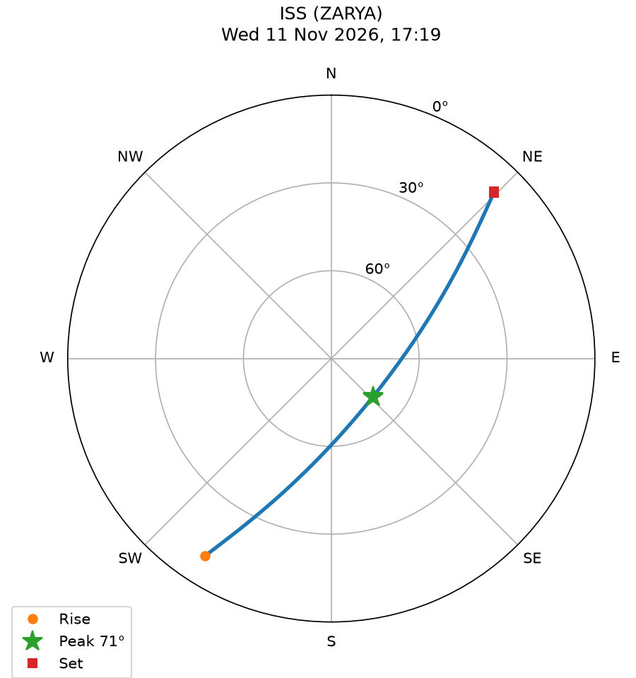

# Satellite Pass Predictor

A Python tool that predicts when a satellite will pass over a ground location. It downloads live orbital data from CelesTrak, propagates the orbit with SGP4, and lists every upcoming pass with its rise time, peak elevation, and direction across the sky.

By default it tracks the International Space Station over Taif, Saudi Arabia.

## How it works

1. **Get the orbit.** Download the satellite's latest two-line element set (TLE) from CelesTrak.
2. **Propagate.** Use the SGP4 model to compute the satellite's position every 5 seconds.
3. **Change frames.** Rotate each position from the inertial TEME frame into the Earth-fixed frame using Greenwich Mean Sidereal Time.
4. **Look up.** Convert to azimuth and elevation as seen from the observer, using the WGS84 Earth model.
5. **Find passes.** A pass is any stretch where the satellite is above the minimum elevation (10° by default).

## Setup

```
pip install -r requirements.txt
```

## Usage

```
python pass_predictor.py
```

Options:

| Option | What it does | Default |
| --- | --- | --- |
| `--catnr` | NORAD catalog number of the satellite | 25544 (ISS) |
| `--lat`, `--lon`, `--alt` | Observer latitude, longitude (degrees) and altitude (meters) | Taif |
| `--days` | How many days ahead to search | 3 |
| `--min-el` | Minimum elevation in degrees | 10 |
| `--utc-offset` | Local time offset from UTC in hours | 3 |
| `--tle-file` | Read the TLE from a file instead of downloading | |
| `--start` | Search start in UTC, `"YYYY-MM-DD HH:MM"` | now |
| `--plot` | Where to save the sky chart | `best_pass.png` |

Examples:

```
python pass_predictor.py --catnr 20580                         # Hubble Space Telescope
python pass_predictor.py --lat 24.71 --lon 46.68 --alt 612     # from Riyadh
python pass_predictor.py --days 7 --min-el 30                  # only high passes this week
```

## Output

The tool prints a table of passes and saves a sky chart of the highest one. Example run for the ISS over Taif on 11 November 2026 (times in local time, UTC+3):

```
Passes of ISS (ZARYA)

Date        Rise      Peak      Set        Max el  Duration   Direction
------------------------------------------------------------------------
Wed 11 Nov  17:19:00  17:22:15  17:25:30    70.7°     6m 30s   SW to NE
Thu 12 Nov  03:09:25  03:12:40  03:15:55    51.0°     6m 30s   NW to SE
Thu 12 Nov  16:31:45  16:34:35  16:37:30    29.7°     5m 45s   S to NE
Thu 12 Nov  18:09:55  18:11:25  18:12:55    12.6°     3m 00s   W to N
Fri 13 Nov  02:21:40  02:25:00  02:28:15    66.6°     6m 35s   NW to SE
Fri 13 Nov  15:45:10  15:46:55  15:48:45    14.3°     3m 35s   S to E
Fri 13 Nov  17:20:50  17:23:30  17:26:15    23.4°     5m 25s   W to N
Sat 14 Nov  01:34:15  01:37:10  01:40:10    29.8°     5m 55s   N to E
Sat 14 Nov  03:12:30  03:13:40  03:14:50    11.5°     2m 20s   W to SW
```

On the sky chart, the center is straight overhead and the outer edge is the horizon.



## Tests

The coordinate math is checked against known reference values:

```
python test_geometry.py
```

## Limitations

- Passes are geometric. The tool does not check whether the satellite is sunlit or the sky is dark, so not every listed pass is visible to the eye.
- A TLE loses accuracy as it ages. The tool downloads a fresh one on each run and warns if the TLE is more than two weeks from the search window.

## Possible next steps

- Flag which passes are visible to the naked eye
- Draw the ground track on a world map
- Track several satellites in one run

## Author

Reema Khalid Al-boqami, Computer Engineering, Taif University
